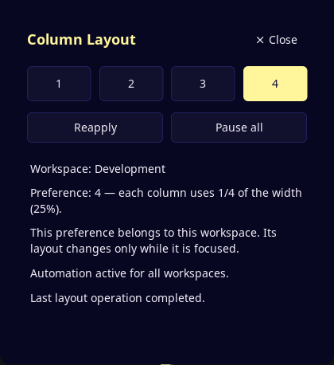

# Niri Auto Tile

> Automatic, balanced column layouts for **niri**, integrated directly into **Noctalia Shell 5**.

[](CHANGELOG.md)
[](https://noctalia.dev/)
[](LICENSE)

Niri Auto Tile keeps tiled columns evenly sized as windows open and close. Pick
how many columns should be visible, then let the plugin continuously maintain a
clean layout—without a separate daemon, manual resizing, or changes to your
niri configuration.

<p align="center">
  
</p>

> [!IMPORTANT]
> Version 2 is a Noctalia 5-only rewrite currently under testing. The previous
> Python/QML line for Noctalia 4 is discontinued. Its settings are not compatible
> with version 2 and are not migrated.

## Why Niri Auto Tile?

Niri's scrolling layout is flexible, but keeping a predictable number of
columns visible can require frequent manual resizing. Niri Auto Tile handles
that small, repetitive job automatically while respecting the way niri works.

- **Automatic redistribution** — reacts to window open/close events and changes to workspace, column, or floating state.
- **Balanced widths** — each tiled column uses the selected fraction of the output width.
- **One-click control** — choose a 1, 2, 3, or 4-column layout from the bar.
- **Stack-aware** — multiple windows stacked in one column count as one column.
- **Floating-friendly** — floating windows are left untouched.
- **Focus-safe** — restores the previously focused window after resizing.
- **Workspace-aware** — redistributes only the focused workspace, leaving other monitors untouched.
- **Persistent** — remembers the selected layout across Noctalia restarts.
- **Lightweight** — runs entirely in Noctalia's Luau plugin runtime.
- **Localized** — includes English, Portuguese (Brazil), German, Spanish, French,
  Italian, Japanese, Korean, Russian, and Chinese translations.

## How the layout works

The selected number is the target number of columns visible at once:

| Selection | Column width | Typical use |
|---:|---:|---|
| 1 | 100% | Focused, single-column work |
| 2 | 50% | Editor plus terminal or browser |
| 3 | ~33% | Multi-app workflows |
| 4 | 25% | Dense, wide-screen layouts |

The selected fraction is applied to every tiled column in the focused workspace,
regardless of the column count. For example, selecting **4** sets each column to
25%, including when there are four or fewer columns. Additional columns remain
accessible through niri's horizontal scrolling.

The preference is global and defaults to **4**, but each redistribution changes
only the focused workspace. Other monitors and unfocused workspaces retain
their current widths. Switching focus alone does not trigger redistribution.

## Requirements

- [Noctalia Shell](https://noctalia.dev/) 5.0 or newer
- [niri](https://github.com/YaLTeR/niri)

`niri` is declared as an external plugin dependency. Noctalia may display
`Requires: niri`; this is informational and does not mean installation failed.

## Installation

### 1. Add and enable the plugin

Install directly from this GitHub repository:

```bash
noctalia msg plugins source add niri-auto-tile git https://github.com/pir0c0pter0/niri-auto-tile
noctalia msg plugins enable pir0c0pter0/niri-auto-tile
```

### 2. Add the widget to your bar

Use Noctalia's bar settings to add the **Niri Auto Tile** widget, or add the
widget definition and its ID to your existing bar configuration. GUI-managed
overrides live in `~/.local/state/noctalia/settings.toml` by default:

```toml
[widget.niri-auto-tile]
type = "pir0c0pter0/niri-auto-tile:widget"

[bar.default]
center = ["date", "clock", "niri-auto-tile"]
```

Keep any widgets already present in your bar list; the example only shows where
`niri-auto-tile` fits. Merge into existing tables instead of duplicating them.
For a hand-written setup, use `~/.config/noctalia/config.toml`; GUI overrides
take precedence. These paths respect Noctalia's configured directory overrides
and the XDG environment variables. See [Noctalia's configuration guide](https://docs.noctalia.dev/noctalia/configuration/).

### 3. Validate and reload Noctalia

```bash
noctalia config validate
noctalia msg config-reload
```

The bar now shows the column icon and the active division. Click it to open the
selector.

## Updating

For the Git source installed above, fetch the latest version and reload its
enabled plugin with:

```bash
noctalia msg plugins update niri-auto-tile
noctalia msg plugins list
```

Use your source's name if you chose a different one during installation.

A hand-installed copy under `~/.local/share/noctalia/plugins/niri-auto-tile/`
takes precedence over Git sources and must be updated separately. Updating the
Git source does not replace that local copy. See [Noctalia's local development guide](https://docs.noctalia.dev/noctalia/plugins/development/workflow/).

## Usage

1. Click the Niri Auto Tile widget in the Noctalia bar.
2. Select a layout from **1** to **4** columns.
3. Open or close tiled windows normally.

Changing the selection applies it immediately to the focused workspace, saves
it to the plugin data directory, and reuses it after Noctalia restarts. Selecting
the already-active value does not force another redistribution. Title changes
alone do not trigger redistribution; moving windows between workspaces or
columns and changing their floating state can trigger it.

You can also open or close the panel externally:

```bash
noctalia msg panel-toggle pir0c0pter0/niri-auto-tile:panel
```

## What happens behind the scenes

The plugin starts with Noctalia, reads niri's current window list, and listens
to `niri msg -j event-stream`. After an open/close event or a change to a window's
workspace, column, or floating state, it:

1. selects the affected workspace only when it is focused;
2. groups its tiled windows by column;
3. calculates the width for the selected visible-column limit;
4. resizes one representative window per column;
5. anchors and centers the visible columns; and
6. restores the window that was focused before redistribution.

Events are briefly coalesced to avoid repeated work during bursts, and another
pass is queued if the layout changes while redistribution is already running.

## Plugin entries

| Entry | ID | Purpose |
|---|---|---|
| Widget | `pir0c0pter0/niri-auto-tile:widget` | Shows the active division and opens the panel |
| Panel | `pir0c0pter0/niri-auto-tile:panel` | Provides the 1–4 column selector |
| Service | `pir0c0pter0/niri-auto-tile:service` | Watches niri and maintains column widths |

## Scope and limitations

Version 2 deliberately keeps one global 1–4 column preference. It does not
provide per-workspace rules, edit `niri` configuration, expose runtime tuning,
or run as a standalone daemon. These were legacy version 1 capabilities and
are not part of the Noctalia 5 rewrite.

The current 2.0.7 version is distributed from this Git repository while live
testing is completed. Published [GitHub releases](https://github.com/pir0c0pter0/niri-auto-tile/releases)
are also available; the plugin has not been submitted to the Noctalia plugin
registry.

## Development

The plugin runs inside Noctalia's Luau runtime and launches `niri msg` commands
for compositor IPC, including a long-lived event stream. It needs no separate
Python daemon or build step. Run the logic checks and Noctalia lint before
submitting changes:

```bash
lua test_service.lua
noctalia plugins lint niri-auto-tile
```

Project structure:

```text
niri-auto-tile/
├── plugin.toml       # Plugin manifest and entry declarations
├── service.luau      # Event handling and redistribution logic
├── widget.luau       # Noctalia bar widget
├── panel.luau        # Column selector panel
└── translations/     # Localized UI strings
```

See the [changelog](CHANGELOG.md) for release history and
[publishing notes](PUBLISHING.md) for the current distribution status.

## License

Released under the [MIT License](LICENSE).
